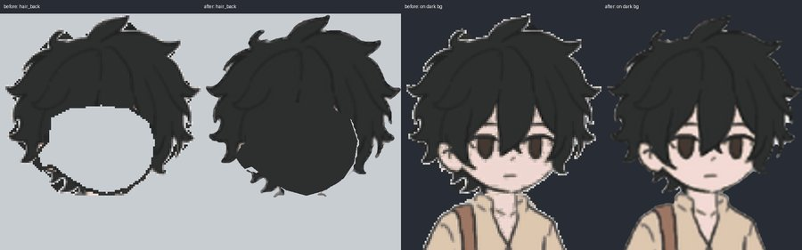
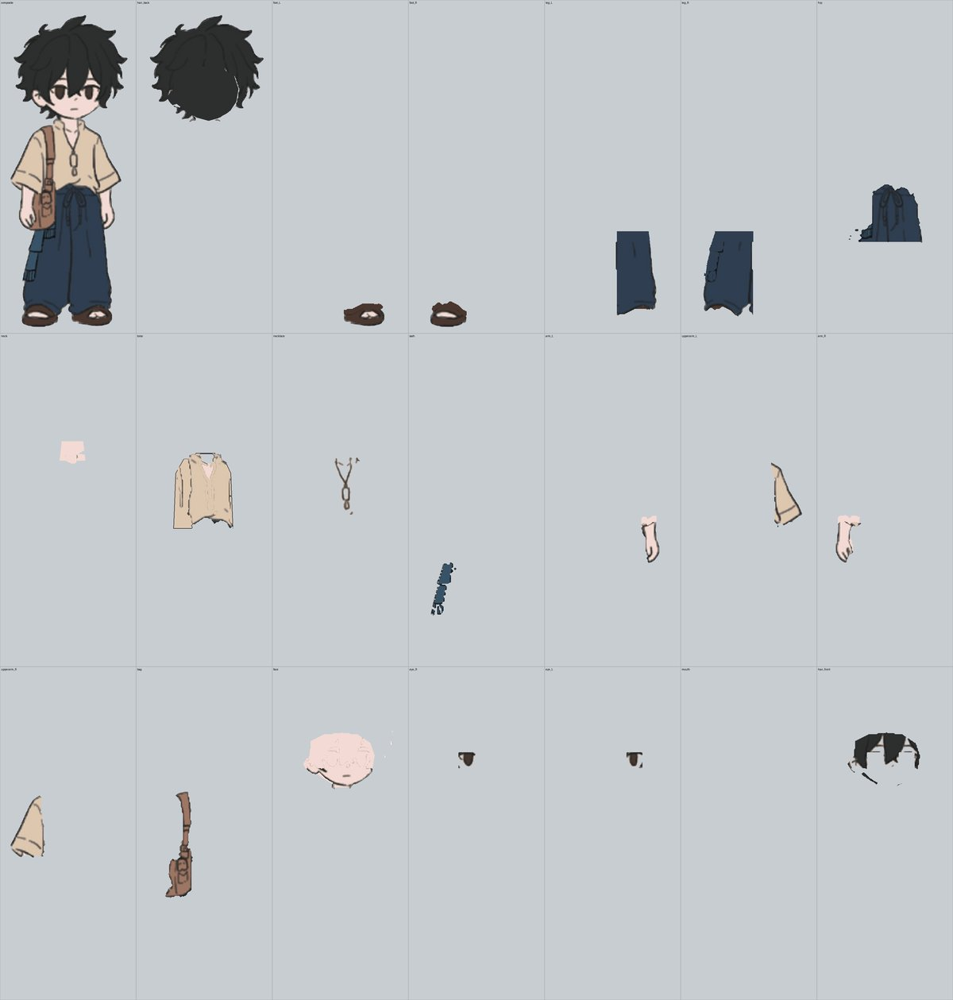

# 01: How `split_layers.py` cuts

Five steps, all inside `main()`:

1. **Alpha unmixing.** `dbg` = distance from the background colour (`bg`, default 245,245,245).
   - `solid` = the inside of the figure (`fill_holes(dbg > 30)`, eroded by 1, with large background
     holes removed, such as the gap between the arm and the body).
   - Each pixel gets `F` = the colour of the nearest solid pixel.
   - `alpha` = projection of (pixel − bg) onto (F − bg).
   - The edge colour is always `F`, so no background colour mixes into the edge: **no white halo**.
2. **Material per pixel.** Nearest colour in `palette`. A line is a dark or grey pixel
   (`dark`: low luminance and not navy/sash colour, or low saturation and fairly dark, or `gray`/`lgray`).
3. **Labels.** Each non-line pixel goes to a part, using polygons (`polys`) plus material conditions
   (`mats`, `not_mats`, `ymin`). Torso pixels outside `full.torso` are cleared.
4. **Lines go to the layer on top.** Each line pixel takes the highest-ranked neighbouring label
   within a radius of 1 to 3. A shared outline therefore stays whole on the upper layer.
5. **Upscale ×`scale` (4).**
   - One gaussian per label, then argmax, so cuts become smooth curves instead of staircases.
   - Areas under `full` polygons that something covers are filled with the flat `fill` colour.
   - `outline_cuts` adds a line along a cut only for layers that need one (front: `torso`).
   - Writes `<layer>.png`, all the same canvas size, plus `_labels.png` for checking.

## Checking a result

- Open `_labels.png`: each layer has its own colour. Look for specks of one colour inside another,
  such as an upperarm speck in the hand; fix that with a polygon or `hem_y`.
- In the contact sheet, every layer on its own must have no white halo and no stray line left from another layer.
- Rotate the arm or leg by ±20° (or run the skinned walk) and check what shows behind it.
