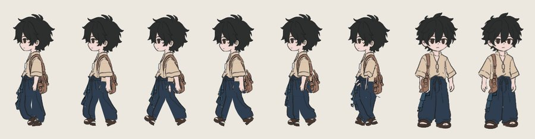
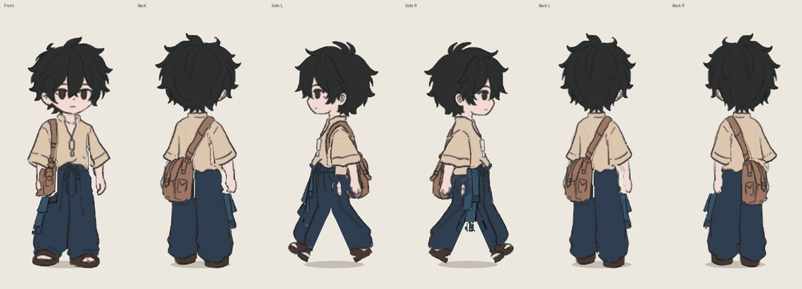

# 03: Smooth walk with bones and weights (Sprite Skin in Python)

Rotating separate pieces always opens a gap or a fold at the joint. Unity 2D Animation solves this
with **Sprite Skin**: each pixel follows several bones by weight. `scripts/skin.py` does the same so
a walk can be checked before rigging:

- `Rig(layer_dir, cfg, rig)`: `rig["bones"]` lists bones (head/tail in source pixels, parents
  first). `rig["bind"]` maps each layer to `[[bone, sigma], ...]`.
- Weights are a gaussian of the distance to each bone segment, normalised, so a knee bends over a
  short smooth band.
- `render(local)`: `local` maps bone → `(rot_deg, dx, dy)` relative to its parent. It uses inverse
  linear blend skinning (3 fixed-point steps, then `cv2.remap`). About 2.5 s per frame.

## Walk cycle numbers (`rigs.py`)

| | Side (`side_walk`) | Front/back (`front_walk`) |
|---|---|---|
| Thigh | ±24° | lifts 3.2 px × 0.35 |
| Knee | folds `30 × max(0,cos)^1.5` while swinging through | lifts × 0.65 |
| Arm | ±24°, opposite to the leg on the same side; forearm bends 8–18° | ±5° |
| Body bob | −1.6 px at contact, +0.6 at passing | same |
| Bag / sash | lag ~0.9 / 1.2 rad behind, 5° / 7° | 3° / 5° |

Take these numbers into the Unity Animation clip as a starting point (12 frames per cycle, ~85 ms per frame).

Known artifacts at this source size: the sash fringe is jagged; in some side frames a small mark
shows where the hand passes the bag. Both come from the low-resolution source, not the method.
